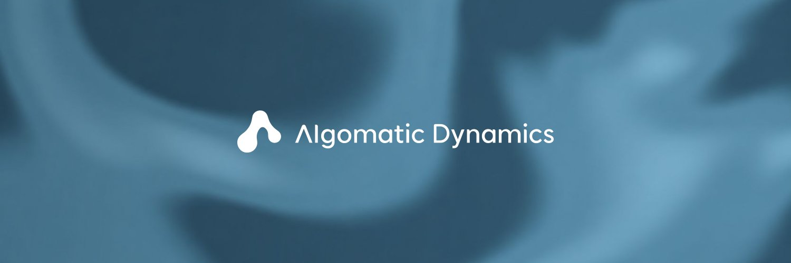

# ghand

[English](./README.md)

**ghandは、多指ロボットハンドの制御・テレオペ・シミュレーション・学習のためのPython SDKです。**

[](https://algomatic-dynamics.com/)

ghandは、[Algomatic Dynamics](https://algomatic-dynamics.com/)のロボットハンド「LEAP V1 KAIZEN」のためのPython SDKです。LEAP V1 KAIZENはLEAP Hand v1系の4指16自由度ハンドで、ロボット学習の研究向けに設計されています。このパッケージは、関節レベルの制御、オペレータWeb UI、MediaPipeによるWebカメラテレオペレーション、MuJoCoシミュレーション、LeRobot連携を提供します。

<table>
<tr>
<th width="50%"><a href="./examples/04_pose_sequence.py"><code>examples/04_pose_sequence.py</code></a>の実行結果</th>
<th width="50%">キューブの手内操作（実機）</th>
</tr>
<tr>
<td>

https://github.com/user-attachments/assets/ecf324b7-3178-4d55-9744-c4e36d94e451

</td>
<td>

https://github.com/user-attachments/assets/88e3a341-87d5-4e12-80e6-18a117da4da2

</td>
</tr>
<tr>
<th>MuJoCoのキューブシーン（<code>--mujoco-scene cube_face_up</code>）</th>
<th>MuJoCoのハンドルシーン（<code>--mujoco-scene turn_handle</code>）</th>
</tr>
<tr>
<td>

https://github.com/user-attachments/assets/91aab1bf-f094-4196-9ea4-8a2599b37b7e

</td>
<td>

https://github.com/user-attachments/assets/f75f754b-fc74-462d-89ac-e0b9c76fcc35

</td>
</tr>
<tr>
<th>オペレータWeb UI（<code>ghand ui</code>）</th>
<th>Rerunビューア（<code>ghand teleop --rerun</code>）</th>
</tr>
<tr>
<td>

https://github.com/user-attachments/assets/0e11f5f0-5e8d-41b9-95f9-ab420718f0f4

</td>
<td>

https://github.com/user-attachments/assets/6a40e5de-6777-4a09-aa5f-7660fe6131df

</td>
</tr>
</table>

## 主な機能

- **Python API**：`Hand`ひとつで仮想ハンド、実機、MuJoCoを同じコードで動かせます。
- **Web UI**：`ghand ui`でトルク、関節目標、緊急停止をブラウザから操作し、3Dモデルで確認できます。
- **Webカメラテレオペ**：`ghand teleop`でMediaPipeが読み取った自分の手の動きをLEAP V1 KAIZENに写せます。
- **Rerun可視化**：`--rerun`でカメラ映像、目標値、計測値、遅延を1つの時間軸で見られます。
- **MuJoCo**：同梱URDFからモデルを自動生成し、キューブとハンドルのシーンですぐ試せます。
- **LeRobot連携**：`ghand record`、`ghand train`、`ghand run-policy`で収録、学習、ポリシー実行ができます。
- **ハードウェア診断**：`ghand doctor`がハンドを動かさずにアダプタとモータ16個を点検します。
- **LEAP Hand互換**：サーボ、モータID、原点が同じで、LEAP向けのコードがそのまま動きます。

## インストール

対応Pythonは3.11と3.12です。

```bash
pip install "ghand[ui,teleop,viewer,sim]"   # またはuv add "ghand[ui,teleop,viewer,sim]"
```

基本パッケージが依存するのは`dynamixel-sdk`、`numpy`、`pyserial`、`rich`、`typer`です。使う機能に応じてextraを足してください。`ui`（Web UI）、`teleop`（Webカメラ）、`viewer`（Rerun）、`sim`（MuJoCo）、`lerobot`（データ収録・学習・ポリシー実行）、`all`（すべて）があります。

## まずは3つのコマンド

```bash
ghand ui                 # 仮想ハンドでオペレータUIを起動。ロボットは不要
ghand doctor             # ハンドをつないでから実行。アダプタ、16個のモータ、ファームウェア、電圧、Homing Offsetを確認
ghand ui --port auto     # 実機で同じUI
```

ブラウザで<http://localhost:8080>を開きます。`--port auto`は、USBシリアルアダプタが1つだけつながっているときにそれを自動で選びます。複数あるときはデバイスパスを指定してください。

## 実機で動かす

```bash
ls /dev/serial/by-id/                      # U2D2アダプタ。再起動しても名前が変わらない
PORT=/dev/serial/by-id/<adapter>
sudo chmod 666 $PORT                        # またはudevルールで自分のグループに権限を付与
echo 1 | sudo tee /sys/bus/usb-serial/devices/$(basename $(readlink -f $PORT))/latency_timer  # Linuxのみ: USBレイテンシタイマを1msに。doctorが確認する
ghand doctor                                # アダプタ、権限、16個のモータ、Homing Offset = 0を確認
ghand ui --port auto                        # トルク操作と緊急停止つきのオペレータUI
ghand teleop --camera 0 --port auto --rerun # Webカメラでテレオペ
```

```python
from ghand import Hand

with Hand.connect("/dev/serial/by-id/<adapter>") as hand:   # アダプタが1つならHand.connect()でも可
    print(hand.joint_positions())            # 計測した関節角（rad）。この時点でトルクは入っている
    hand.move_to({"index_mcp_flex": -0.6}, seconds=1.0)   # 曲げる向きが負
    hand.move_to("home", seconds=1.0)                        # 原点姿勢（手を開いた状態、全関節0）
# ブロックを抜けるとトルクが切れる
```

Python APIもUIやテレオペと同じ安全処理を通るので、関節の可動範囲、速度制限、緊急停止はスクリプトにも効きます。サンプルは[examples/](./examples/)にあります。

`Hand.connect(..., dry_run=True)`はモータへの書き込みをすべて止めるので、実機につないだままスクリプトを予行できます。トルクを入れる前の確認項目は[ハードウェア設定](./docs/en/getting-started/hardware-setup.md)を参照してください。

## ハードウェアなしで試す

- `ghand ui`と`Hand.fake()`は仮想ハンドを動かします。物理シミュレーションはなく、指示した関節角がそのまま計測値として返ります。モータとの通信は起きません。
- `ghand teleop --mujoco`と`Hand.mujoco()`はMuJoCoで物理シミュレーションしたハンドを動かします。モデルは同梱のURDFから初回実行時に自動生成されるので、ダウンロードは不要です。

## テレオペ、収録、学習

```bash
ghand download-hand-model                                    # MediaPipeの手検出モデルを取得（初回のみ）
ghand teleop --camera 0 --port auto --rerun                  # Webカメラの手の動き → LEAP V1 KAIZEN
ghand record --repo-id <user>/ghand-demo --port auto         # テレオペをLeRobotデータセットに収録
ghand train --repo-id <user>/ghand-demo                      # LEAP V1 KAIZEN向けの設定で学習
ghand run-policy --policy-path outputs/train/<run> --backend mujoco   # 学習したポリシーをMuJoCoで実行
```

`ghand[lerobot]`を入れると`lerobot_robot_ghand`も一緒に入り、LeRobotのコマンドで`--robot.type=ghand`がそのまま使えます。

## LEAP Handから移る方へ

LEAP V1 KAIZENはLEAP Hand v1と互換になるように作られています。サーボ、モータID、サーボの原点が同じなので、LEAP Hand APIとそれ向けに書かれたコードはそのままLEAP V1 KAIZENを動かせます。ghandのPython APIは関節を名前で扱い、手を開いた姿勢を0とするラジアンで表します。LEAPのベクトルとの相互変換には`ghand.hand.leap`の関数を使ってください。詳細は[移行ノート](./docs/en/guides/coming-from-leap-hand.md)を参照してください。

## ドキュメント

- [ドキュメント入口](./docs/en/index.md)
- [クイックスタート](./docs/en/getting-started/quickstart.md)
- [ハードウェア設定](./docs/en/getting-started/hardware-setup.md)
- [テレオペレーション](./docs/en/guides/teleoperation.md)
- [LeRobotデータセットと学習](./docs/en/data-and-learning/lerobot-dataset.md)
- [MuJoCo](./docs/en/simulation/mujoco.md)
- [CLIリファレンス](./docs/en/reference/cli.md)と[Python APIリファレンス](./docs/en/reference/python-api/control-and-hardware.md)

## ライセンス

コード、同梱URDF、メッシュはApache-2.0です。メッシュはシミュレーションと表示のために提供するもので、ハンドの製造用CADはこのリポジトリに含まれません。[LICENSE](./LICENSE)、[NOTICE](./NOTICE)、[CITATION.cff](./CITATION.cff)を参照してください。

ROBOTIS製部品（DYNAMIXEL XC330サーボと、そのフレーム、ホーン、コネクタ部品）のメッシュは、ROBOTISが公開している図面を寸法の参考にしてAlgomatic Dynamicsが独自にモデリングしたもので、ROBOTISのCADデータではありません。DYNAMIXELはROBOTIS Co., Ltd.の商標です。

## 貢献

開発環境と確認手順は[CONTRIBUTING.md](./CONTRIBUTING.md)を参照してください。
