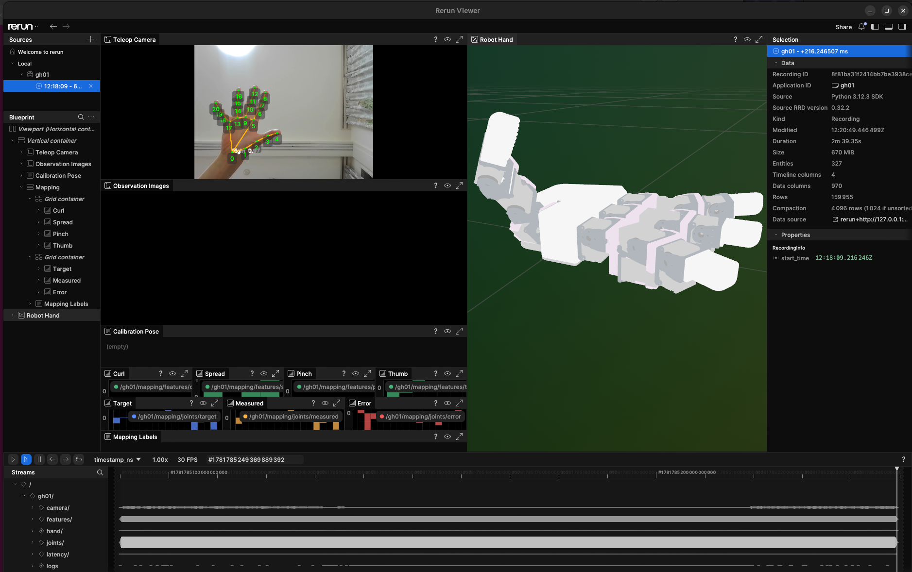

# Teleoperation

`teleop` connects MediaPipe hand tracking to the ghand retargeter and then to
a fake, real, or MuJoCo hand backend.

Omit `--port` and `--mujoco` to use the fake backend. Tracking and smoothing use
shared defaults: up to two hands, detection confidence 0.6, tracking confidence
0.7, and a One Euro filter with minimum cutoff 1 Hz and beta 20. On real
hardware, `teleop` and `record` clear the Dynamixel velocity and acceleration
profiles so the hand follows the operator at full motor speed; the operator UI
keeps the slower runtime defaults. Simulation actuator parameters use the normal
runtime defaults.

## Prepare the tracker

Download the MediaPipe hand landmarker model once:

```bash
uv run ghand download-hand-model
```

Verify the camera separately before enabling a hand backend:

```bash
uv run ghand webcam-check --camera 0
uv run ghand track --camera 0 --display
```

## Real-hardware teleoperation

Complete [Hardware setup](../getting-started/hardware-setup.md), keep the hand
clear, and start with Rerun diagnostics visible:

```bash
uv run ghand teleop \
  --port /dev/ttyUSB0 \
  --camera 0 \
  --rerun
```

`--rerun` displays the camera, selected operator hand, retargeting features,
joint targets, runtime state, and timing signals.



The operator-hand selector keeps one tracked person locked when multiple hands
are visible. A track change resets temporal landmark filtering so samples from
different hands are not blended.

## MuJoCo teleoperation

```bash
uv run --extra sim ghand teleop \
  --mujoco \
  --mujoco-viewer \
  --mujoco-scene turn_handle
```

This uses the same retargeting and runtime target path with a MuJoCo backend. See
[MuJoCo](../simulation/mujoco.md) for model caching and control semantics.

## Calibration and missing-hand behavior

Use a captured calibration file when the default mapping does not fit the
operator. The full capture and inspection workflow is in
[Calibration and diagnostics](calibration-and-diagnostics.md).

`teleop` exposes only the choices an operator makes: the backend, the camera,
the hand side, the calibration file, the frame budget and loop rate, Rerun
output, the control mode, and dry run. The rest is fixed: the camera opens at
640x480, the serial bus runs at 1,000,000 bps, and when the tracked hand is
lost the last target is held for 0.5 s before the hand returns to the home
pose. The full option list is generated from the implementation in the
[CLI reference](../reference/cli.md).
