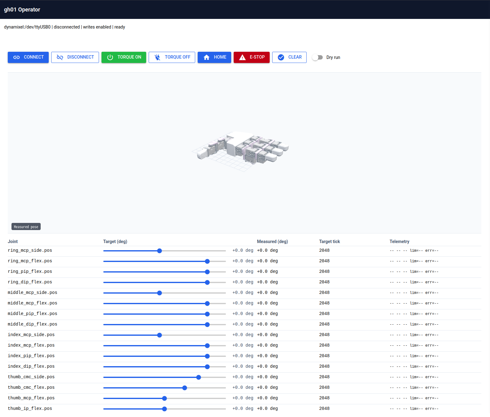

# Web UI

The operator Web UI exposes connection, torque, homing, joint-target, telemetry,
and emergency-stop controls together with a URDF view of the hand.

## Fake backend

Use the fake backend to inspect the UI without a robot:

```bash
uv run --extra ui ghand ui
```

Omitting `--port` selects the fake backend.

## Real backend

Complete [Hardware setup](../getting-started/hardware-setup.md), then run:

```bash
uv run --extra ui ghand ui --port /dev/serial/by-id/<adapter>
```

Open <http://localhost:8080>. Use `--ui-port` to change the HTTP port; `--port`
always refers to the Dynamixel serial device.



## Operation

Click **Start / Resume** to connect, synchronize targets with the measured pose,
and enable torque. **Stop** releases torque while leaving the connection open;
**Start / Resume** continues from the current measured pose. **E-stop** stops
immediately; the same explicit Start / Resume action clears it and resumes.
**Home** commands the neutral pose while running.

Disconnect and Dry run are under **Connection settings**. Changing Dry run
stops and disconnects the hand; Start / Resume applies the selected mode.
Normal operation uses the shared hand profile rather than the slower motor test
profile. The status reports running, stopped, or E-stop.

The complete option list is generated from the implementation in the
[CLI reference](../reference/cli.md).
